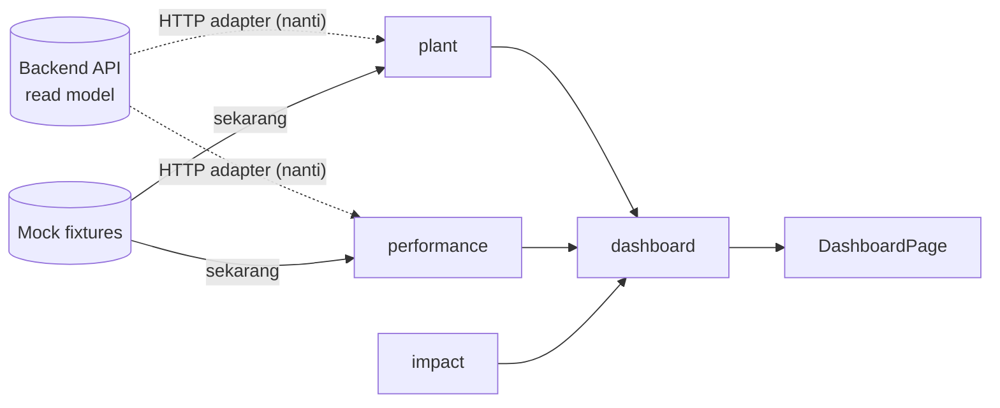
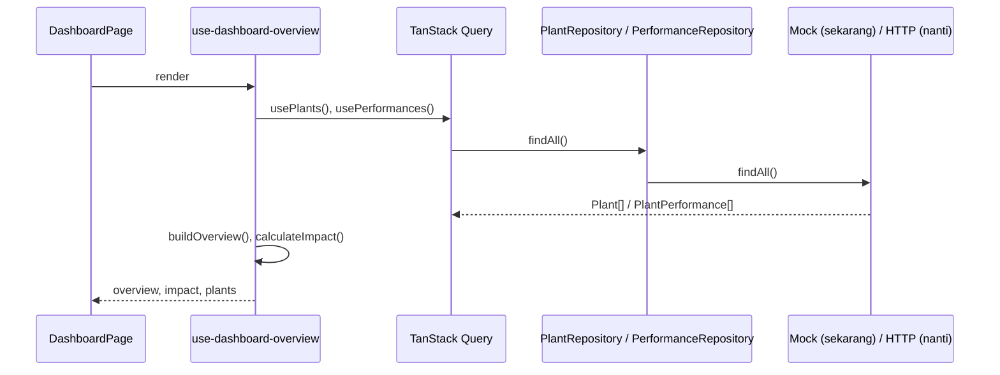

# Tynext EMS — Arsitektur DDD Frontend untuk Dashboard

Dokumen ini menjabarkan arsitektur Domain-Driven Design (DDD) untuk **frontend** halaman
Dashboard Tynext EMS: peta sebaran plant, kartu summary, Environmental Benefits, BESS
performance (charge/discharge), dan tabel Plant List.

Stack: **Vite + React 19 + TypeScript + Tailwind v4**, TanStack Query (server state),
react-router, Leaflet (peta), vitest (test domain). Mengikuti keputusan stack di
`rain-ems/docs/IMPLEMENTATION_PLAN.md` Fase 9 dan pola folder `src/domains/` yang sudah
dipakai tim.

---

## 1. Ubiquitous Language

| Istilah | Arti |
|---|---|
| **Plant / Site** | Satu instalasi PLTS (PV, bisa dengan BESS) di satu lokasi. "Total Sites" = jumlah plant. |
| **Device** | Perangkat di plant: inverter, battery/BMS, PCS, meter, data logger. |
| **PV Capacity (kWp)** | Kapasitas terpasang panel surya. |
| **Inverter Capacity (kW)** | Kapasitas daya inverter. |
| **Battery / BESS Capacity (kWh)** | Kapasitas energi baterai. |
| **Energy Generation (kWh)** | Energi yang dihasilkan PV. |
| **Charge / Discharge (kWh)** | Energi yang masuk ke / keluar dari baterai. |
| **Tariff (Rp/kWh)** | Harga jual energi per kWh. |
| **Revenue (Rp)** | Pendapatan dari energi yang dihasilkan × tariff. |
| **Plant Status** | `ONLINE`, `ALARM`, atau `OFFLINE` (lihat §4.1). |
| **Active Site** | Plant yang tidak `OFFLINE`; pembilang di kartu "Total Sites x/y". |
| **Environmental Benefits** | Equivalent trees, CO₂ reduction, coal saved — dihitung dari energy generation. |

---

## 2. Bounded Context di Frontend

Frontend tidak memiliki sumber kebenaran; ia **memproyeksikan** read model dari backend.
Tetap ada logika domain yang pantas hidup di client: aturan status, rumus environmental
impact, agregasi summary, dan query tabel (filter/sort/paginasi). Logika itulah yang
diisolasi di layer `domain/` dan diuji tanpa React.

| Context (`src/domains/…`) | Jenis | Tanggung jawab | Widget |
|---|---|---|---|
| **plant** | Core | `Plant` (identitas, lokasi, owner, kapasitas, device, cuaca, `plantType` Resort / Hotel · Mining · Plantation), **StatusPolicy**, ketersediaan inverter | Peta, kolom identitas di tabel, status badge |
| **performance** | Core | Read model energi & revenue per plant (`PlantPerformance`), penjumlahan | Energy Generation, Revenue, Charge/Discharge, kolom energi di tabel |
| **impact** | Supporting | `EmissionFactors` + rumus pohon / CO₂ / batubara | Environmental Benefits |
| **telemetry** | Core | `PowerSample`/`PowerSnapshot` (PV, load, genset, baterai, grid, SoC; baterai charge +, discharge − sesuai spesifikasi), `batteryStatus`, `deriveEnergyFlow` (arah aliran ke/dari bus AC), deret 5 menit per hari | Diagram aliran energi, kartu SoC, grafik daya & SOC harian |
| **alarm** | Supporting | `Alarm` aktif/riwayat per plant, pengurutan (aktif → severity → terbaru) | Halaman Alarm, badge jumlah alarm di sidebar |
| **device** | Core | `DeviceRecord` (union Inverter/Battery/PCS/Meter; perangkat berdiri sendiri, tanpa hierarki), `deviceStatus`, katalog parameter per tipe (`instant` vs `energy`), `groupByUnit` (satu chart per satuan), query daftar, `sameKindDevices` (daftar sejenis di samping detail); port `DeviceRepository` + `DeviceTelemetryRepository` (pembacaan terbaru, deret 5 menit, batang energi). Mock-nya menurunkan angka dari telemetri & performa plant dan membagi energi baterai per unit | Halaman Device (daftar per tipe), detail perangkat + daftar sejenis, chart parameter |
| **maintenance** | Supporting | `MaintenanceActivity` (tanggal, tipe Regular/Corrective, aktivitas, foto, catatan, `completedAt`), **`maintenanceStatus`** (Done/Upcoming/Pending diturunkan, tidak disimpan), `validateDraft`, `applyPatch`, `applyMaintenanceQuery`; port `MaintenanceRepository` (`findByPlant`, `create`, `update`). Mock: seed relatif hari ini + lapisan perubahan di localStorage | Halaman O&M schedule (tabel, form tambah, panel detail) |
| **auth** | Generic (Identity & Access) | `Session`/`User`/`Credentials`, `validateCredentials`, `displayNameFromEmail`; port `AuthRepository` (`current`, `signIn`, `signInWithProvider`, `signOut`). Mock: email valid apa pun + kata sandi ≥ 6 karakter, sesi di localStorage | Halaman login (form + ilustrasi SVG beranimasi), `RequireAuth`, menu pengguna |
| **scada** | Generic (integrasi) | `ScadaEmbed` (URL viewer pihak ketiga per plant, template `{plantId}`), validasi URL yang boleh disematkan; tidak ada diagram buatan sendiri | Halaman SCADA (iframe ber-sandbox + kontrol) |
| **dashboard** | Komposisi (read side) | Menggabungkan context lain menjadi `DashboardOverview` dan `PlantListPage`; **tidak punya aturan bisnis sendiri** | Halaman dashboard, summary strip, Plant List |
| **site** | Komposisi (read side) | Layout sidebar + header plant; menggabungkan plant, telemetry, performance (operating data per periode, seri energi, tarif), alarm, impact, scada; `site/domain/chart-data.ts` memetakan read model → titik chart (murni, diuji) | Halaman Overview (tile, grafik), SCADA (embed), Info, Device, Alarm; O&M schedule masih stub berlabel |

Cuaca masuk ke context `plant` sebagai value object `WeatherSnapshot` karena di dashboard
ia hanya atribut tampilan per plant. Identity & Access belum ada (user menu masih dummy).

### Context map



Aturan ketergantungan antar context:

- `dashboard` boleh meng-import `plant`, `performance`, `impact`; `site` boleh meng-import
  `plant`, `performance`, `telemetry`, `alarm`.
- `performance`, `telemetry`, `alarm` boleh meng-import **tipe** `PlantId` dari `plant`
  (shared identifier); adapter mock mereka membaca fixture `plant` supaya angka dummy konsisten.
- `plant`, `impact` tidak meng-import context lain.
- Tidak ada context yang meng-import `src/app/`.

Halaman site memakai rute bersarang (`/plants/:plantId/{scada|info|device|alarm|om-schedule}`);
`SiteLayout` memuat plant, snapshot telemetri (refresh 5 detik), dan alarm sekali, lalu
membagikannya ke halaman anak lewat `Outlet` context.

---

## 3. Layer di Dalam Satu Context

```
src/domains/<context>/
├── domain/          # tipe, value object, policy, fungsi murni — TANPA React/fetch
├── application/     # port (interface repository), context provider port, hook query
├── infrastructure/  # adapter port: mock (sekarang), http (nanti)
├── ui/              # komponen React yang hanya memakai domain + application
└── index.ts         # API publik context
```

Arah dependensi: `ui → application → domain ← infrastructure`.

- **domain/** hanya TypeScript murni, diuji dengan vitest (`environment: node`).
- **application/** mendefinisikan *port* (`PlantRepository`, `PerformanceRepository`) dan
  hook TanStack Query (`usePlants`, `usePerformances`). Hook mengambil implementasi port
  dari React context (`PlantRepositoryProvider`) — bukan import langsung — supaya mock
  dan HTTP bisa ditukar tanpa menyentuh UI.
- **infrastructure/** berisi adapter. `MockPlantRepository` menurunkan `status` dari
  `devices` lewat `derivePlantStatus`, persis seperti yang nanti dilakukan mapper HTTP
  terhadap DTO backend.
- **ui/** tidak boleh memanggil fetch atau menghitung rumus; ia memanggil hook dan fungsi
  domain.

### Composition root

`src/app/container.ts` adalah satu-satunya tempat yang memilih adapter
(`VITE_DATA_SOURCE=mock|http`) dan `src/app/providers.tsx` memasangnya ke context tiap
domain. Mengganti data dummy ke API = menulis `HttpPlantRepository` +
`HttpPerformanceRepository` lalu mengubah satu baris di `container.ts`.

### Struktur folder

```
src/
├── main.tsx
├── app/
│   ├── App.tsx            # routes
│   ├── providers.tsx      # QueryClient + provider port tiap domain
│   └── container.ts       # composition root (mock | http)
├── shared/
│   ├── domain/            # shared kernel: units (KWh, IDR, formatter id-ID), geo
│   ├── config/env.ts
│   ├── lib/               # cn, queryClient, apiClient
│   └── ui/                # primitif mengikuti kit HeroUI di Figma: Button, Chip, Tabs,
│                          # Input/SearchField/Field, DataTable, Pagination, Panel/Card, Drawer,
│                          # Dialog, Alert/Toast, EmptyState (ilustrasi Figma), BottomSheet,
│                          # AppHeader (Last Updated + refresh + menu profil), Brand, Skeleton
├── domains/
│   ├── plant/
│   │   ├── domain/        # plant.ts, status-policy.ts (+test), weather.ts
│   │   ├── application/   # plant-repository.ts (port), context, use-plants.ts
│   │   ├── infrastructure/# fixtures.ts (14 plant dummy), mock-plant-repository.ts
│   │   └── ui/            # PlantMap, PlantStatusBadge, WeatherIcon, PlantDetailPage
│   ├── performance/
│   │   ├── domain/        # performance.ts (PlantPerformance, sumPerformance)
│   │   ├── application/   # port, context, use-performances.ts
│   │   └── infrastructure/# mock-performance-repository.ts
│   ├── impact/
│   │   ├── domain/        # impact.ts (EmissionFactors, calculateImpact) (+test)
│   │   └── ui/            # EnvironmentalBenefitsPanel
│   └── dashboard/
│       ├── domain/        # overview.ts (buildOverview), plant-list.ts (query tabel) (+test)
│       ├── application/   # use-dashboard-overview.ts, use-plant-list.ts
│       └── ui/            # DashboardPage, KpiCards, BessPerformanceCard,
│                          # PlantListPanel, PlantTable
└── styles/index.css       # token tema dari Figma (Tailwind v4 @theme): latar/panel/kartu,
                           # brand #087fb2, accent #0485f7, status ok/warn/danger + varian teks,
                           # tema gelap, override Leaflet (popup kartu hover site)
```

---

## 4. Logika Domain

### 4.1 `plant` — StatusPolicy

| Status | Aturan |
|---|---|
| `OFFLINE` | Semua device terputus (atau belum ada device) |
| `ALARM` | Minimal satu device punya alarm aktif, **atau** sebagian (tidak semua) device terputus |
| `ONLINE` | Semua device terhubung dan tidak ada alarm aktif |

```ts
export function derivePlantStatus(devices: readonly Device[]): PlantStatus {
  const connected = devices.filter((d) => d.connected).length;
  const hasAlarm = devices.some((d) => d.activeAlarms > 0);
  if (connected === 0) return "OFFLINE";
  if (hasAlarm || connected < devices.length) return "ALARM";
  return "ONLINE";
}
```

Juga: `inverterAvailability(devices)` → kolom "Inverter Online/Total", `isActive(status)`,
`countByStatus(plants)` → angka di tab Plant List.

Di produksi status datang dari backend; policy ini tetap dipakai mock dan sebagai
fallback mapper, sehingga definisi status di client dan server satu sumber.

### 4.2 `performance`

`PlantPerformance { plantId, generationKWh, chargeKWh, dischargeKWh, tariffIDRPerKWh, revenueIDR }`
adalah read model lifetime per plant. `sumPerformance()` menjumlahkan untuk summary.
Tidak ada perhitungan revenue di frontend; backend yang menghitung per hari dengan tarif
yang berlaku pada hari itu.

### 4.3 `impact`

Rumus dari spesifikasi, faktor sebagai konfigurasi (`EmissionFactors`), bukan konstanta
di komponen:

| Metrik | Rumus | Satuan |
|---|---|---|
| CO₂ reduction | `0,0008 × E` | ton |
| Equivalent trees | `E × 0,80 / 21,77` | pohon |
| Coal saved | `0,00004 × E` | ton |

`E` = Total Energy Generation (kWh).

### 4.4 `dashboard`

- `buildPlantSummary(plants)` → total/active sites, PV kWp, BESS kWh, `statusCount`;
  `buildPerformanceSummary(performances)` → generation, revenue, `bess` (charge/discharge);
  `roundTripEfficiency(bess)`. `buildOverview` menggabungkan keduanya. Dipisah supaya tiap kartu KPI
  memuat dan gagal sendiri-sendiri (PRD Home).
- `applyPlantListQuery(rows, query)` → filter status + search (nama/alamat/ID), sort
  (`name | status | generation | revenue | pvCapacity`), paginasi dengan page di-clamp.

Sesuai catatan di low-fi, filter **My Favorites, Plant Type, Investment Type tidak dibuat**.

---

## 5. Pemetaan Widget → Sumber Data

| Widget (low-fi) | Fungsi / hook | Context |
|---|---|---|
| TOTAL SITES `x/y` | `summary.activeSites / summary.totalSites` | dashboard ← plant |
| PV Install Capacity (kWp) | `summary.pvCapacityKWp` | dashboard ← plant |
| BESS Install Capacity (kWh) | `summary.bessCapacityKWh` | dashboard ← plant |
| Energy Generation | `summary.generationKWh` (diskalakan kWh/MWh/GWh) | dashboard ← performance |
| Revenue | `summary.revenueIDR` (diskalakan rb/jt/M/T) | dashboard ← performance |
| Charge / Discharge | `bess.chargeKWh`, `bess.dischargeKWh` | dashboard ← performance |
| Environmental Benefits | `calculateImpact(summary.generationKWh)` | impact |
| Peta + warna marker | `plants[].location.point`, `status` | plant |
| Plant List + tab status | `usePlantList()` → `applyPlantListQuery` | dashboard |
| Kolom Weather | `plant.weather` → `WeatherIcon` | plant |
| Kolom Inverter Online/Total | `inverterAvailability(plant.devices)` | plant |
| Tombol Operation | navigasi `/plants/:id` (placeholder) | plant |

Angka ditampilkan dengan locale `id-ID` (`1.250,40 kWp`, `Rp 260.482.000`) lewat
`shared/domain/units.ts`; komponen tidak memformat sendiri.

---

## 6. State & Data Flow

- **Server state**: TanStack Query. Satu query per port (`["plants"]`, `["performances"]`);
  dashboard dan Plant List berbagi cache yang sama sehingga data hanya diambil sekali.
- **UI state**: lokal di hook/komponen (`usePlantList` menyimpan query tabel; `expanded`
  dan draft pencarian di `PlantListPanel`). Belum perlu store global.
- **URL state**: sheet Site List terbuka = hash `#site-list`, supaya bisa dibagikan dan
  tombol Back menutupnya.
- **Refresh global**: `shared/lib/refresh.ts` membaca cache TanStack Query untuk "Last Updated"
  (dataUpdatedAt terbesar dari query aktif), memuat ulang semua query aktif saat tombol refresh ditekan,
  dan memantau status online browser; data lama tetap tampil selama refresh.
- **Derivasi**: semua agregasi dilakukan di `useMemo` memanggil fungsi domain murni.

### Layout: peta penuh + bottom sheet

Peta memenuhi viewport (`h-dvh`, body `overflow: hidden`); summary strip, Environmental
Benefits, dan BESS performance melayang di atasnya. Plant List hidup di `BottomSheet`
(`shared/ui`): saat tertutup hanya bar 76 px yang terlihat; geser/klik membuka dengan
spring (framer-motion), geser ke bawah / backdrop / tombol tutup / Escape menutup.
Konten sheet scroll sendiri; area pegangan (`dragControls`) terpisah dari area scroll
supaya gestur tidak bertabrakan. `prefers-reduced-motion` → perpindahan tanpa animasi.
Di layar sempit, panel Environmental Benefits dan BESS dipindah ke dalam sheet.



Polling/realtime (status marker) bisa ditambahkan lewat `refetchInterval` atau WebSocket
di adapter tanpa mengubah domain maupun UI.

---

## 7. Kontrak API yang Diharapkan dari Backend

Supaya adapter HTTP tinggal dipasang, backend cukup menyediakan:

| Endpoint | Dipetakan ke |
|---|---|
| `GET /api/v1/plants` | `Plant[]` (termasuk `status`, `devices` ringkas, `weather`) |
| `GET /api/v1/plants/performance` | `PlantPerformance[]` |

Agregasi summary boleh tetap dilakukan di client (14–100 plant masih ringan). Bila jumlah
plant membesar, pindahkan `buildOverview` ke endpoint `GET /api/v1/dashboard/overview`
dan ganti `useDashboardOverview` untuk memakainya — domain lain tidak terpengaruh.

---

## 8. Hal yang Perlu Dikonfirmasi

1. **Faktor coal saved.** `0,00004 t/kWh` = 0,04 kg batubara per kWh. Referensi umum PLTU
   sekitar 0,4 kg/kWh (`0,0004`). Perlu dicek apakah ada salah ketik satu angka nol.
2. **Satuan Battery Capacity.** Di spesifikasi tertulis "kWp"; untuk baterai seharusnya **kWh**.
3. **Definisi "90/90" di Total Sites.** Diasumsikan *plant yang tidak OFFLINE / total*.
4. **Status saat sebagian inverter terputus.** Policy ini menjadikannya `ALARM` (contoh:
   Sudamala Seraya Resort 7/8 inverter). Di low-fi (produk referensi) statusnya Online.
5. **Periode angka summary.** Diasumsikan lifetime. Bila perlu filter tanggal, tambahkan
   `period` ke port `PerformanceRepository`.
